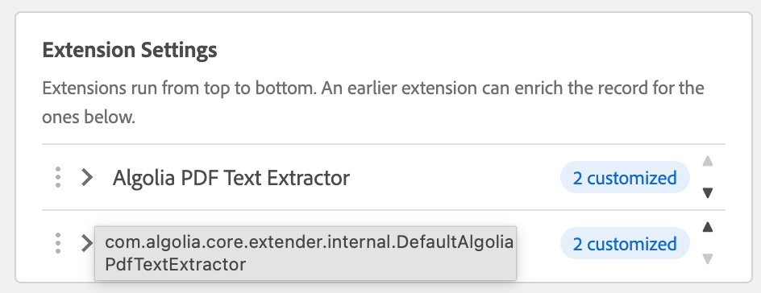

# Building Custom Extensions

The classes in this project are reference implementations. Copy their shape when you need fields the indexer does not add on its own: a computed attribute, a transformed tag title, extra records for a large payload, or a per-index rule that gates whether a resource is indexed at all.

The indexer invokes every extender selected on the Cloud Service configuration **Advanced** tab while it builds the indexing payload. Your service can add, change, or remove attributes, and it can add records. It cannot replace the indexer’s decision to index the resource; aborting indexing is a separate introspector hook.

---

## Table of contents

1. [Choose an interface](#choose-an-interface)
2. [Register the OSGi service](#register-the-osgi-service)
3. [Author-facing settings](#author-facing-settings)
4. [Augment the request](#augment-the-request)
5. [Compile against the indexer](#compile-against-the-indexer)
6. [Ship and select the service](#ship-and-select-the-service)
7. [Custom introspectors](#custom-introspectors)
8. [Backward compatibility](#backward-compatibility)

---

## Choose an interface

| Interface | Called for | Method |
|---|---|---|
| `AlgoliaPageRequestExtender` | Pages | `augmentAlgoliaRequest(AlgoliaRequest request, Page page)` |
| `AlgoliaAssetRequestExtender` | Assets | `augmentAlgoliaRequest(AlgoliaRequest request, Asset asset)` |

Implement one interface, or both when the same logic applies to pages and assets. `DefaultAlgoliaTagsExtractor` implements both and delegates to one private method. `DefaultAlgoliaPdfTextExtractor` implements only the asset interface, because PDF text does not apply to pages.

Both interfaces are `@ConsumerType`. The indexer calls `augmentAlgoliaRequest` after it has created the `AlgoliaRequest` and its initial record.

---

## Register the OSGi service

Declare the service interfaces explicitly when a class implements more than one, so OSGi publishes each contract:

```java
@ComponentServiceProperties(description = "My page and asset extender")
@Component(
        service = {
                AlgoliaPageRequestExtender.class,
                AlgoliaAssetRequestExtender.class
        }
)
public class MyRequestExtender
        implements AlgoliaPageRequestExtender, AlgoliaAssetRequestExtender {
```

`@ComponentServiceProperties` is an OSGi component property type from the indexer (`PREFIX_` is `service.`). Its `description` becomes `service.description`.

The Cloud Service dropdown uses that description as the option label. If `service.description` is empty, the dropdown falls back to the component name (`@Component(name = "...")`). The option **value** stored on the configuration is the implementation class name, not the label. Existing configurations therefore survive a later label change.

Both shipped extractors set `service.description`: **Algolia PDF Text Extractor** and **Algolia Tags Extractor**. Prefer `@ComponentServiceProperties` for a label you control independently of the component name.

A single-interface component can rely on Declarative Services to publish the implemented interface:

```java
@ComponentServiceProperties(description = "My asset extender")
@Component
public class MyAssetExtender implements AlgoliaAssetRequestExtender {
```

Inject indexer or AEM services with `@Reference` on the constructor, as both reference implementations do.

---

## Author-facing settings

Author-facing settings use `ConfigurableRequestExtender`. Declare the fields, then read what the author saved from the request while `augmentAlgoliaRequest` runs.

`ConfigurableRequestExtender` is not a service contract, so set `service` explicitly. Otherwise Declarative Services also publishes the class under `ConfigurableRequestExtender`.

```java
@ComponentServiceProperties(description = "My asset extender")
@Component(service = AlgoliaAssetRequestExtender.class)
public class MyAssetExtender implements AlgoliaAssetRequestExtender, ConfigurableRequestExtender {

    @Override
    public List<ExtenderConfigField> getConfigFields() {
        return List.of(
                ExtenderConfigField.builder("attributePrefix", "Attribute Prefix")
                        .helpText("Prefix added to every attribute name, e.g. \"doc_\" → doc_body.")
                        .build()
        );
    }

    @Override
    public void augmentAlgoliaRequest(AlgoliaRequest request, Asset asset) {
        String prefix = request.getExtenderSettings().getString("attributePrefix");
    }
}
```

The Cloud Service configuration lists each selected extender as a row under **Extension Settings**. Rows run from top to bottom: drag the handle on the left, or use the arrows, to set that order. An earlier extender can write attributes that a later one reads. Hover a name to see the implementation class. The badge shows **Defaults** while every field still uses its default, or how many values are customized. Extenders that declare no fields appear as **No settings** and stay collapsed. Page and asset selections are stored separately, so the same extender can be given different values on each list.



Field types are text, textarea, number, checkbox, select, password, and LLM provider (see [Calling an LLM](#calling-an-llm)), and `helpText` appears as an info tooltip.

Only values that differ from a field's default are saved. Text, textarea, number, and password fields show the default as a placeholder; leaving one blank keeps the default, so a later change to `defaultValue` still applies. A saved value is a string; `ExtenderSettings` parses numbers, booleans, and comma-separated lists, and falls back to the field default when the author has not saved one.

`AlgoliaRequest.getExtenderSettings()` never returns null. When no extender is running, or when that extender has no saved settings, it returns `ExtenderSettings.empty()`. Guard with a fallback anyway if you construct requests in unit tests:

```java
ExtenderSettings settings = request.getExtenderSettings();
if (settings == null) {
    settings = ExtenderSettings.empty();
}
```

Deployment-wide defaults can still use an OSGi `@ObjectClassDefinition`, the same pattern as the PDF extractor’s `word_size_limit`. An author value on the Cloud Service configuration overrides that default for the index being built.

### Calling an LLM

LLM endpoints are defined once per Cloud Service configuration, under **Advanced → LLM Providers**. Each provider holds an inference URL, a model, and an encrypted API key. An extender that calls an LLM declares one field of type `LLM_PROVIDER`, named `llmProviderId`, and the author picks a provider from it:

```java
ExtenderConfigField.builder("llmProviderId", "LLM Provider")
        .type(ExtenderConfigField.Type.LLM_PROVIDER)
        .build()
```

At indexing time, call `LlmProviderResolver.resolve(request.getConfig(), settings)`. It returns the selected provider. For configurations saved before providers existed, it falls back to the legacy inline `inferenceUrl`, `model`, and `inferenceApiKey` settings. The API key on the provider is still encrypted; decrypt it with `AlgoliaUtil.unprotectText`. Treat every LLM failure as non-fatal, so the resource still indexes without the enrichment attributes.

To make **Test connection** in the provider dialog work for your extender, implement `com.algolia.connector.core.inference.InferenceProbe` on the extender class itself and register it as an OSGi service next to the extender interface, as `DefaultAlgoliaPdfTextExtractor` does. `testConnection` should use the same host allow-list, timeout, and response-format flag as indexing. Indexer core **5.0.0** or newer is required.

---

## Augment the request

```java
@Override
public void augmentAlgoliaRequest(AlgoliaRequest request, Page page) {
    AlgoliaRecord record = request.getAlgoliaRecords().get(0);
    record.addAttribute("contentType", "article");
}
```

Guidelines that match the shipped extenders:

- Read the resource from `request.getResource()` when the JCR node is what you need. Use the `Page` or `Asset` argument for API that is not on that resource (template, MIME type, renditions).
- Update the record you mean to update. When the PDF extractor splits an asset, it adds further records with `request.addRecord` and moves the original to the request's retained records. The shipped extractors therefore write their attributes to every active and retained record, so split records carry them too.
- Keep each record within Algolia’s size limits. The PDF extractor treats 10 KB of extracted text as the point where one asset becomes many records, and it names the new object IDs `{originalObjectID}_{index}`.
- Do not assume your extender is the only one selected. Another extender may have already changed the first record, or may run after you. Authors set that order in **Extension Settings**. Put the PDF Text Extractor above the Tags Extractor when tag enrichment should see `pdfText` and `pdfLanguage`.
- Leave the request unchanged when your input is absent (the PDF extractor ignores non-PDFs and empty text) so unrelated resources still index.

---

## Compile against the indexer

Add the indexer core JAR to the bundle’s Maven dependencies. This project uses:

```xml
<dependency>
    <groupId>com.algolia</groupId>
    <artifactId>algolia-aem-indexer.core</artifactId>
    <version>5.0.0</version>
</dependency>
```

**4.9.0 or newer** is required for `ConfigurableRequestExtender`, `ConfigurableResourceIntrospector`, `ExtenderConfigField`, `ExtenderSettings`, and `AlgoliaRequest.getExtenderSettings()`. **5.0.0 or newer** is required for the `com.algolia.connector.core.inference` package (LLM providers and probes). Extenders that only implement `augmentAlgoliaRequest` still compile against older indexer cores, but this 1.2.0 package needs 5.0.0.

Packages you will import:

| Package | Types |
|---|---|
| `com.algolia.connector.core.extender` | `AlgoliaPageRequestExtender`, `AlgoliaAssetRequestExtender`, `ConfigurableRequestExtender`, `ExtenderConfigField`, `ExtenderSettings` |
| `com.algolia.connector.core.domain` | `AlgoliaRequest`, `AlgoliaRecord` |
| `com.algolia.connector.core.annotation` | `ComponentServiceProperties` |
| `com.algolia.connector.core` | `PdfTextExtractor`, `TagsParserService`, `AlgoliaConstants`, `AlgoliaResourceIntrospector`, `ConfigurableResourceIntrospector` |

`algolia-aem-indexer.core` must be on the Maven classpath at build time and installed in AEM at runtime. The extender bundle does not embed the indexer.

Put new classes in the `core` module, next to the reference implementations, or in your own bundle that imports the same packages. The `all` package embeds `algolia-aem-extensions.core` only. A separate bundle needs its own content package or an extra `<embedded>` entry.

---

## Ship and select the service

1. Build and deploy with the commands in [Installation](INSTALLATION.md#build-and-install).
2. Confirm the component is active in the OSGi console and that it is registered under the extender interface you implemented.
3. Open the indexer Cloud Service configuration, **Advanced** tab, and select the service in **Page Request Extender Services**, **Asset Request Extender Services**, or both. The lists are multi-select.
4. If the service implements `ConfigurableRequestExtender`, expand its row under **Extension Settings** and fill in the fields. Drag the row to set when it runs relative to the other selected extenders.
5. Publish or reindex a resource that uses that configuration.
6. In Algolia, open the record and confirm the attributes you added. For a split PDF, expect several object IDs derived from the asset path.

Unit-test the extender by constructing it with mocks for its `@Reference` services and an `AlgoliaRequest` that already contains one record. The tests under `core/src/test/java/com/algolia/core/extender/internal/` cover the PDF and tags classes that way.

---

## Custom introspectors

Implement `AlgoliaResourceIntrospector` to abort indexing. Select the service under **Introspector Services**. The shipped sample is documented in [Property Value Introspector](INTROSPECTOR.md).

Implement `ConfigurableResourceIntrospector` as well when authors should enter settings on the Cloud Service configuration. The settings row appears under **Introspector Settings**. Introspectors run from top to bottom, and the first one that returns `ABORT` stops indexing. `ConfigurableResourceIntrospector` is not a service contract; set `service` to `AlgoliaResourceIntrospector` only.

```java
@ComponentServiceProperties(description = "My Property Introspector")
@Component(service = AlgoliaResourceIntrospector.class)
public class MyPropertyIntrospector implements AlgoliaResourceIntrospector,
        ConfigurableResourceIntrospector {

    @Override
    public List<ExtenderConfigField> getConfigFields() {
        return List.of(
                ExtenderConfigField.builder("propertyName", "Property Name")
                        .helpText("JCR property whose value triggers abort.")
                        .build(),
                ExtenderConfigField.builder("abortValue", "Abort Value")
                        .helpText("Abort indexing when the property equals this string.")
                        .build()
        );
    }

    @Override
    public Outcome introspect(Resource resource) {
        return introspect(resource, ExtenderSettings.empty());
    }

    @Override
    public Outcome introspect(Resource resource, ExtenderSettings settings) {
        String property = settings.getString("propertyName");
        String abortValue = settings.getString("abortValue");
        if (property.isEmpty() || abortValue.isEmpty()) {
            return Outcome.CONTINUE;
        }
        Object value = resource.getValueMap().get(property);
        return abortValue.equals(String.valueOf(value)) ? Outcome.ABORT : Outcome.CONTINUE;
    }
}
```

The two-argument `introspect` method has a default on `AlgoliaResourceIntrospector` that ignores settings and calls `introspect(Resource)`. Override it only when you read `ExtenderSettings`.

---

## Backward compatibility

Keep these rules in mind when you upgrade the indexer or this package, or when you already have custom OSGi services in production.

**Existing custom extenders keep running.** The `augmentAlgoliaRequest` signatures did not change. `ConfigurableRequestExtender` is optional. An extender that does not implement it still appears in the dropdowns; the settings row shows **No settings**.

**Existing custom introspectors keep running.** The indexer always calls `introspect(Resource, ExtenderSettings)`. If your class does not override that method, the default delegates to `introspect(Resource)`, which is the contract used before 4.9.0.

**Existing Cloud Service selections keep working.** The wizard stores class names, not dropdown labels. A rename of `service.description` (for example **Algolia Default Tags Extractor** → **Algolia Tags Extractor**) does not clear a saved selection.

**Empty settings equal previous hard-coded behavior.** `ExtenderSettings` falls back to each field’s `defaultValue`, then to the fallback you pass to `getString` / `getInt` / `getBoolean`. Design new fields so the default matches what the extender did before authors could edit it. The shipped extractors follow that rule; see [Installation — Backward compatibility](INSTALLATION.md#backward-compatibility).

**Indexer 4.9.0 is the floor for settings APIs, and 5.0.0 for LLM APIs.** Bundles that import `ConfigurableRequestExtender`, `ConfigurableResourceIntrospector`, or `ExtenderSettings` will not resolve against an indexer core older than 4.9.0. Bundles that import `com.algolia.connector.core.inference` need 5.0.0. This 1.2.0 package imports both, so deploy indexer 5.0.0 or newer first.

**Do not publish the settings interfaces as OSGi services.** Set `@Component(service = …)` to the extender or introspector contract only. Otherwise Declarative Services also registers `ConfigurableRequestExtender` or `ConfigurableResourceIntrospector`, which pollutes the service registry.

---

**Related docs**

| Doc | Topics |
|---|---|
| [Installation](INSTALLATION.md) | Prerequisites, Maven build, deploy profiles, backward compatibility |
| [PDF Text Extractor](PDF_TEXT.md) | Asset extender with OSGi configuration and record splitting |
| [Tags Extractor](TAGS.md) | Dual page and asset registration |
| [Property Value Introspector](INTROSPECTOR.md) | Shipped introspector and its settings |
