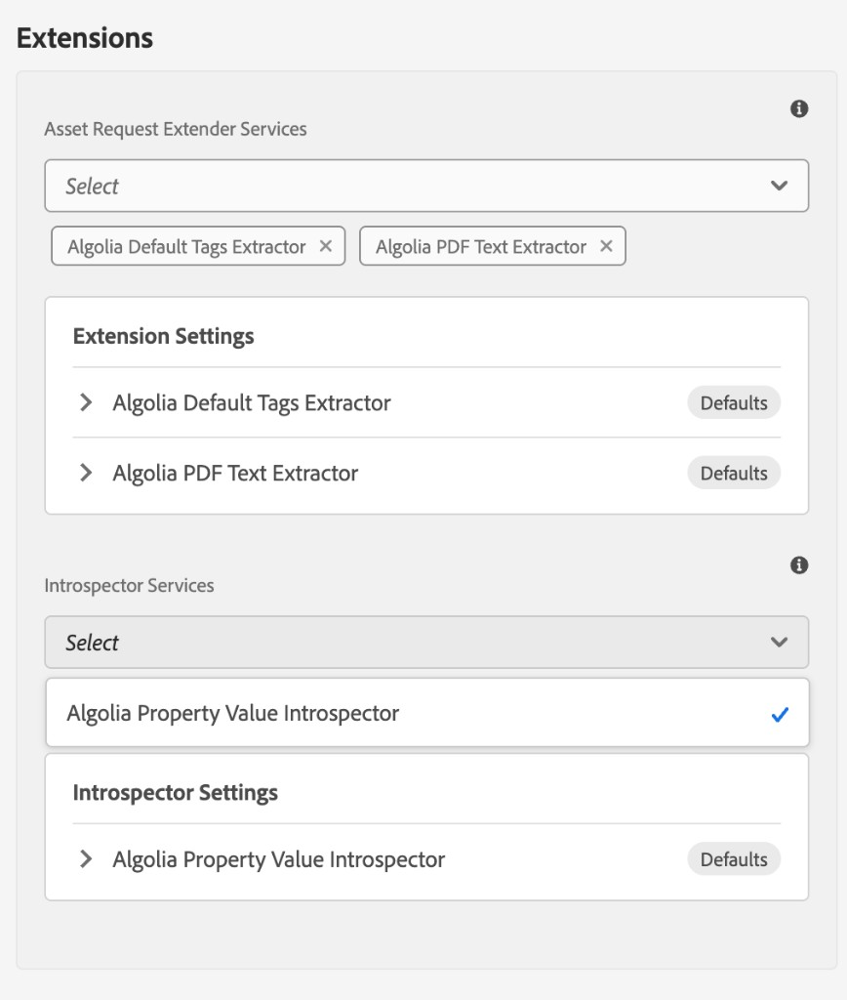

# Installation Guide

How to build and install the **Algolia AEM Extensions** package (`algolia-aem-extensions.all`) so the reference indexing extenders and introspector are available to the Algolia Connector for Adobe Experience Manager.

> **This package does not index content by itself.** Install and configure [`algolia-aem-indexer`](https://github.com/algolia/algolia-aem-indexer) first. The services in this project run during the indexer’s page and asset indexing and depend on APIs the indexer provides.

> **No warranties or SLA.** This project is a reference implementation, provided as-is. There is no service level agreement and no guarantee of support. Use it as a starting point and adapt it to your requirements.

---

## Table of contents

1. [Introduction](#introduction)
2. [Supported versions and runtimes](#supported-versions-and-runtimes)
3. [Before you start](#before-you-start)
4. [Modules](#modules)
5. [Build and install](#build-and-install)
6. [Select the services](#select-the-services)
7. [Backward compatibility](#backward-compatibility)
8. [Testing](#testing)
9. [Maven settings](#maven-settings)

---

## Introduction

The extensions package ships three OSGi services that run while the indexer prepares records:

| Service | Applies to | What it does |
|---|---|---|
| [PDF Text Extractor](PDF_TEXT.md) | Assets | Text extracted from PDF renditions, split across attributes or records when the text is large |
| [Tags Extractor](TAGS.md) | Pages and assets | Tag titles read from a JCR tag property (`cq:tags` by default) |
| [Property Value Introspector](INTROSPECTOR.md) | Pages, assets, and content fragments | Aborts indexing when a JCR property equals a configured value |

The extractors are request extenders. The introspector is a separate hook that can skip a resource before a record is built. After you install the package, select the services on the indexer Cloud Service configuration. See [Building custom extensions](CUSTOM_EXTENSIONS.md) if you need a different payload or abort rule.

---

## Supported versions and runtimes

| | |
|---|---|
| **AEM version** | 6.5+ (AEM SDK API `2025.12`) |
| **Java** | 11 or newer, for the Maven build |
| **Indexer dependency** | `algolia-aem-indexer.core` **4.9.0** or newer (required for Extension Settings and Introspector Settings) |
| **Installation and runtime** | On-premises, Adobe Managed Services, and AEM as a Cloud Service |

The PDF extractor also embeds Apache OpenNLP `opennlp-tools` **2.5.0**, used to split extracted text on whitespace.

---

## Before you start

1. Install `algolia-aem-indexer.all` **4.9.0 or newer** and upload a valid Algolia license. Indexing stays inactive until the license is in place. Extension Settings and Introspector Settings are indexer features; this package will not resolve against an older indexer core.
2. Create an indexer Cloud Service configuration and assign it to the sites or DAM folders you index.
3. Host `algolia-aem-indexer.core` where this project’s Maven build can resolve it. The core module declares it as a compile dependency:

```xml
<dependency>
    <groupId>com.algolia</groupId>
    <artifactId>algolia-aem-indexer.core</artifactId>
    <version>4.9.0</version>
</dependency>
```

The indexer project documents how to install that JAR in a local or private Maven repository.

You need Maven 3.3.9 or newer.

---

## Modules

| Module | Artifact | Role |
|---|---|---|
| **core** | `algolia-aem-extensions.core` | OSGi bundle with `DefaultAlgoliaPdfTextExtractor`, `DefaultAlgoliaTagsExtractor`, and `DefaultAlgoliaPropertyValueIntrospector` |
| **all** | `algolia-aem-extensions.all` | Container content package. Embeds the core bundle at `/apps/algolia-extensions-packages/application/install` |

An `it.tests` module is present for HTTP integration tests against a running AEM instance. It is not part of the reactor, so `mvn clean install` from the project root does not run it.

---

## Build and install

From the project root:

```bash
mvn clean install
```

That builds the core bundle and the `all` package. The installable file is:

`all/target/algolia-aem-extensions.all-1.1.0.zip`

### Deploy to a local author

```bash
mvn clean install -PautoInstallSinglePackage
```

Publish instance:

```bash
mvn clean install -PautoInstallSinglePackagePublish
```

Or point the author install at another port:

```bash
mvn clean install -PautoInstallSinglePackage -Daem.port=4503
```

Bundle only, to the author:

```bash
mvn clean install -PautoInstallBundle
```

A single content package, run from that module (for example `all`):

```bash
mvn clean install -PautoInstallPackage
```

Default connection settings are `localhost:4502` (author) and `localhost:4503` (publish), with user `admin` / `admin`. Override them with `aem.host`, `aem.port`, `aem.publish.host`, `aem.publish.port`, `sling.user`, `sling.password`, `vault.user`, and `vault.password`.

---

## Select the services

Installing the package registers the services. Indexing does not call them until a Cloud Service configuration selects them.

On the indexer Cloud Service configuration **Advanced** tab, under **Extensions**, pick one or more services. Which extender list is shown depends on the **Indexing** choice on the Properties tab:

- **Page** shows **Page Request Extender Services**.
- **Asset** and **Content Fragment** show **Asset Request Extender Services**.
- Every indexing type shows **Introspector Services**.

You can select several services in the same list. A typical asset configuration selects both extractors:



| List | Service to select | Label |
|---|---|---|
| **Asset Request Extender Services** | `com.algolia.core.extender.internal.DefaultAlgoliaPdfTextExtractor` | Algolia PDF Text Extractor |
| **Asset Request Extender Services** | `com.algolia.core.extender.internal.DefaultAlgoliaTagsExtractor` | Algolia Tags Extractor |
| **Page Request Extender Services** | `com.algolia.core.extender.internal.DefaultAlgoliaTagsExtractor` | Algolia Tags Extractor |
| **Introspector Services** | `com.algolia.core.introspector.internal.DefaultAlgoliaPropertyValueIntrospector` | Algolia Property Value Introspector |

The dropdown label is the OSGi `service.description` when the component sets one, and the component name otherwise. The stored value is the implementation class name, so a later label change does not break an existing configuration.

Each selected service that declares author fields appears as a collapsible card:

- Extenders under **Extension Settings**
- Introspectors under **Introspector Settings**

The card header shows **Defaults** while every field still uses its default. Open a card to change Tag Property, Word Size Limit, Property Name, and the other per-index settings. See [PDF Text Extractor](PDF_TEXT.md), [Tags Extractor](TAGS.md), and [Property Value Introspector](INTROSPECTOR.md).

Reindex or publish a page or PDF asset that uses the configuration, then confirm the new attributes on the Algolia record.

---

## Backward compatibility

Extensions **1.1.0** moves author settings from hard-coded values (and, for PDF word count, a global OSGi config) onto the Cloud Service configuration. Existing indexes and custom bundles keep working when you upgrade in this order: indexer **4.9.0 or newer**, then this package.

### Existing Cloud Service configurations

Configurations created before 1.1.0 already store extender and introspector class names as String arrays (`pageRequestExtenderServices`, `assetRequestExtenderServices`, `introspectorServices`). Those properties are unchanged. The new JSON properties (`pageRequestExtenderSettings`, `assetRequestExtenderSettings`, `introspectorSettings`) are empty until an author opens a settings card and saves a non-default value.

Empty settings are treated as defaults. Those defaults match the previous hard-coded behavior:

| Service | Default that preserves 1.0.x records |
|---|---|
| Tags Extractor | Tag Property `cq:tags`, empty Attribute Prefix |
| PDF Text Extractor | Attribute Name `pdfText`, empty Attribute Prefix, Split Oversized Text on, Word Size Limit from the OSGi config (900 unless you changed it) |
| Property Value Introspector | Not selected on existing configurations. If selected with blank Property Name or Expected Value, it never aborts |

You do not have to re-select the services or re-save the configuration after upgrade. Reindex only if you change a setting and want existing Algolia records to pick it up.

### Dropdown labels

The tags extractor label is now **Algolia Tags Extractor**. Earlier releases showed **Algolia Default Tags Extractor**. The value stored on the configuration is still `com.algolia.core.extender.internal.DefaultAlgoliaTagsExtractor`, so existing selections keep working.

### Custom extenders and introspectors

Custom OSGi services that implement only `AlgoliaPageRequestExtender`, `AlgoliaAssetRequestExtender`, or `AlgoliaResourceIntrospector` do not need code changes.

- Extenders that do not implement `ConfigurableRequestExtender` still appear in the dropdowns and still run. They have no author fields, so the settings card shows **No settings**.
- Introspectors that do not override `introspect(Resource, ExtenderSettings)` keep using `introspect(Resource)`. The indexer calls the two-argument method; the default implementation ignores settings and delegates.
- `AlgoliaRequest.getExtenderSettings()` returns an empty settings object when nothing was saved, so older extenders that never call it are unaffected.

To compile against `ConfigurableRequestExtender`, `ConfigurableResourceIntrospector`, or `ExtenderSettings`, depend on indexer core **4.9.0 or newer**. See [Building custom extensions](CUSTOM_EXTENSIONS.md#backward-compatibility).

### OSGi Word Size Limit

The PDF extractor’s OSGi metatype **DefaultAlgoliaPdfTextExtractor Configuration** (`word.size.limit`, default 900) is still the fallback when **Word Size Limit** on the Cloud Service card is blank. A deployment-wide OSGi overlay continues to apply until an author enters a value on a specific index.

---

## Testing

### Unit tests

```bash
mvn clean test
```

The core module tests the PDF extractor (mime type, empty text, word-limit splits, the 10 KB record split, author settings), the tags extractor (page and asset paths both call `TagsParserService`, tag property and prefix), and the property value introspector (string / integer / boolean match, missing property, invalid settings).

### Integration tests

`it.tests` talks to a running AEM instance over HTTP. It is not a reactor module. From `it.tests`:

```bash
mvn clean verify -Plocal
```

Test classes live under `src/main/java` and must match `*IT.java`.

| Property | Description | Default |
|---|---|---|
| `it.author.url` | Author URL | `http://localhost:4502` |
| `it.author.user` | Author user | `admin` |
| `it.author.password` | Author password | `admin` |
| `it.publish.url` | Publish URL | `http://localhost:4503` |
| `it.publish.user` | Publish user | `admin` |
| `it.publish.password` | Publish password | `admin` |

---

## Maven settings

The project expects Adobe’s public Maven repository. To add it to your settings, follow [Set up the Adobe Maven repository](http://helpx.adobe.com/experience-manager/kb/SetUpTheAdobeMavenRepository.html).

---

**Related docs**

| Doc | Topics |
|---|---|
| [PDF Text Extractor](PDF_TEXT.md) | `pdfText` attributes, word limit, record splitting |
| [Tags Extractor](TAGS.md) | Tag property and prefix on pages and assets |
| [Property Value Introspector](INTROSPECTOR.md) | Abort indexing on a JCR property value |
| [Custom extensions](CUSTOM_EXTENSIONS.md) | Writing and registering your own extender or introspector |
