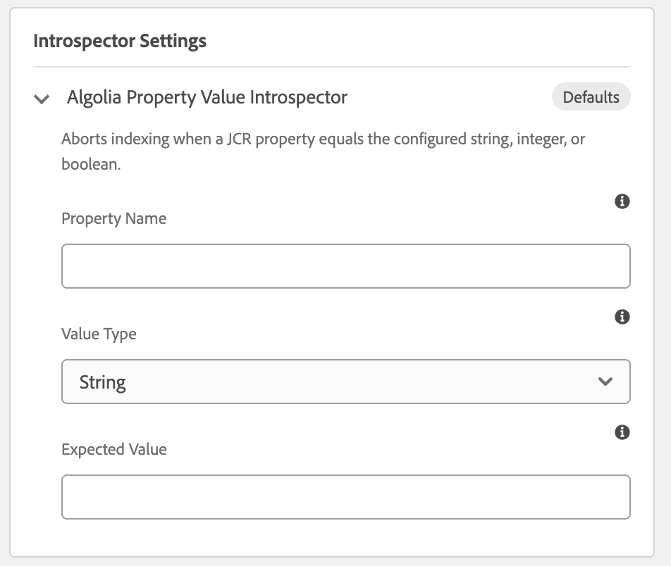

# Property Value Introspector

`DefaultAlgoliaPropertyValueIntrospector` aborts indexing when a JCR property equals a configured string, integer, or boolean. Unlike the extenders it has no `@Reference` dependencies and no global OSGi configuration. Settings are per Cloud Service index, on the **Advanced → Extensions → Introspector Settings** card.

Source: [`DefaultAlgoliaPropertyValueIntrospector`](../core/src/main/java/com/algolia/core/introspector/internal/DefaultAlgoliaPropertyValueIntrospector.java).

---

## Table of contents

1. [Registration](#registration)
2. [When it aborts](#when-it-aborts)
3. [Settings](#settings)
4. [Common example — skip `noindex` pages](#common-example--skip-noindex-pages)
5. [Backward compatibility](#backward-compatibility)

---

## Registration

```java
@ComponentServiceProperties(description = "Algolia Property Value Introspector")
@Component(service = AlgoliaResourceIntrospector.class)
public class DefaultAlgoliaPropertyValueIntrospector implements AlgoliaResourceIntrospector,
        ConfigurableResourceIntrospector {
```

`ConfigurableResourceIntrospector` is not a service contract. The `@Component` `service` attribute is set to `AlgoliaResourceIntrospector` only, so Declarative Services does not also publish the class under `ConfigurableResourceIntrospector`.

`@ComponentServiceProperties` sets `service.description` to **Algolia Property Value Introspector**. That string is the label in **Introspector Services**. The value stored on the configuration is the class name `com.algolia.core.introspector.internal.DefaultAlgoliaPropertyValueIntrospector`.

Select it under **Introspector Services**. The list is available for page, asset, and content fragment configurations.

---

## When it aborts

The indexer calls `introspect(resource, settings)` before it builds the record. The service returns `ABORT` when the named property equals the expected value, and `CONTINUE` otherwise.

A bare property name is resolved on the resource, then `jcr:content`, `jcr:content/metadata`, and `jcr:content/data/master`. A relative path such as `jcr:content/cq:robotsTags` is read from that node. Multi-value properties abort when **any** value matches.

Indexing continues when:

- Property Name or Expected Value is empty
- Value Type is not String, Integer, or Boolean
- Expected Value is not a whole number (Integer) or `true` / `false` (Boolean)
- The property is missing
- The stored value does not equal the expected value

---

## Settings

Authors set these on the Cloud Service configuration, under **Introspector Settings**, after selecting **Algolia Property Value Introspector** in **Introspector Services**.



| Field | Type | Default | Description |
|---|---|---|---|
| **Property Name** | text | — | JCR property to compare. A bare name is resolved on the resource, `jcr:content`, `jcr:content/metadata`, and `jcr:content/data/master`. A relative path like `jcr:content/cq:robotsTags` is read from that node. |
| **Value Type** | select | String | How to interpret the expected value and the stored property. Options: String, Integer, Boolean. |
| **Expected Value** | text | — | Indexing is aborted when the property equals this value. Integers are whole numbers; booleans are `true` or `false`. |

The card header shows **Defaults** until you change a field. Only values that differ from a field's default are saved.

---

## Common example — skip `noindex` pages

1. Open the Cloud Service configuration, **Advanced** tab.
2. Select **Algolia Property Value Introspector** under **Introspector Services**.
3. In the **Introspector Settings** card that appears, set **Property Name** to `jcr:content/cq:robotsTags` and **Expected Value** to `noindex`. Leave **Value Type** as String.
4. Save the configuration. Pages whose `jcr:content/cq:robotsTags` property contains `noindex` are now excluded from indexing for this configuration.

---

## Backward compatibility

This service is new in extensions **1.1.0**. Existing Cloud Service configurations do not select it, so they keep indexing every resource they indexed before.

When the introspector **is** selected but Property Name or Expected Value is left blank, it never aborts. That is the same as not selecting it.

Custom introspectors that only implement `introspect(Resource)` keep working on indexer **4.9.0** and newer. The two-argument `introspect(Resource, ExtenderSettings)` method has a default that ignores settings and delegates to the original method. See [Building custom extensions](CUSTOM_EXTENSIONS.md#backward-compatibility).

---

**Related docs**

| Doc | Topics |
|---|---|
| [Installation](INSTALLATION.md) | Build, deploy, and select the introspector |
| [Tags Extractor](TAGS.md) | Page and asset tags extender |
| [PDF Text Extractor](PDF_TEXT.md) | Asset-only text extraction and record splitting |
| [Custom extensions](CUSTOM_EXTENSIONS.md) | `AlgoliaResourceIntrospector` and `ConfigurableResourceIntrospector` |
