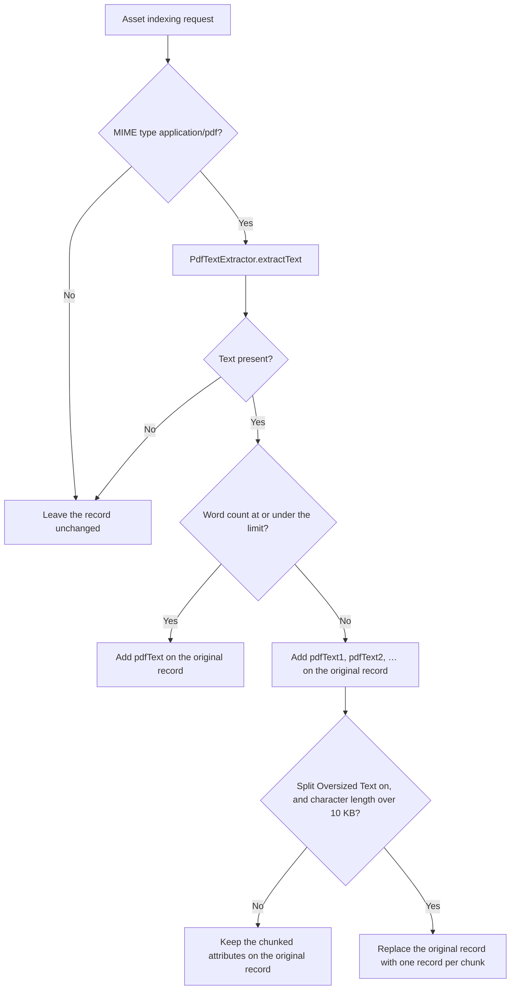
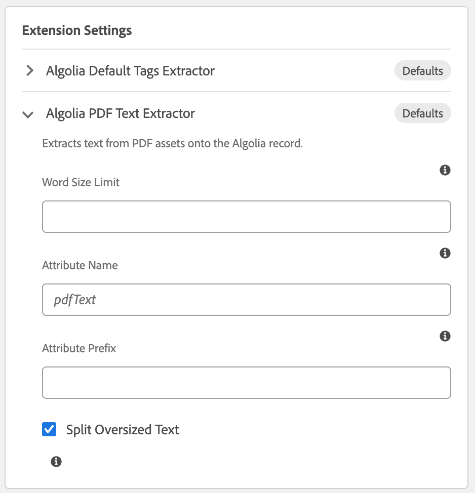

# PDF Text Extractor

`DefaultAlgoliaPdfTextExtractor` is an asset request extender. When the indexer prepares a record for a PDF asset, this service reads the document text and writes it onto the Algolia record so the PDF body is searchable.

Source: [`DefaultAlgoliaPdfTextExtractor`](../core/src/main/java/com/algolia/core/extender/internal/DefaultAlgoliaPdfTextExtractor.java).

---

## Table of contents

1. [When it runs](#when-it-runs)
2. [How text is stored](#how-text-is-stored)
3. [Record splitting](#record-splitting)
4. [Configuration](#configuration)
5. [Backward compatibility](#backward-compatibility)
6. [Dependencies](#dependencies)

---

## When it runs

The component is an OSGi service with `service.description` **Algolia PDF Text Extractor**. It implements `AlgoliaAssetRequestExtender` only, so it appears in **Asset Request Extender Services** and not in the page list. You can select it together with other asset extenders, such as the [Tags Extractor](TAGS.md).

`augmentAlgoliaRequest` runs after the indexer has created the asset’s `AlgoliaRequest`. The method returns immediately unless the asset MIME type is `application/pdf`. Non-PDF assets, including a null MIME type, are left unchanged.

For a PDF, it calls the indexer’s `PdfTextExtractor.extractText`. Empty or null text is ignored. The original record is not given a text attribute in that case.

---

## How text is stored

Words are counted with OpenNLP `WhitespaceTokenizer`. The limit is **Word Size Limit** from Extension Settings. When that field is blank, the OSGi **Word Size Limit** is used (default **900**).

| Extracted text | Attributes written | Records |
|---|---|---|
| Word count ≤ limit | One attribute, `pdfText` (or the configured name), holding the full string | The original asset record |
| Word count > limit, and the string is 10 KB or shorter | `pdfText1`, `pdfText2`, … each holding up to the word limit | Still the original asset record |
| Word count > limit, the string is longer than 10 KB, and Split Oversized Text is on | Each chunk becomes the text attribute of its own record | The original record is removed. See [Record splitting](#record-splitting) |
| Word count > limit, the string is longer than 10 KB, and Split Oversized Text is off | Numbered chunks stay on the original record | The original asset record |

A chunk is the word limit words, joined with single spaces. The last chunk holds the remainder. Attribute numbering starts at `pdfText1` (or `{name}1`). There is no bare `pdfText` attribute once the word count exceeds the limit.

Example with the default limit of 900 and 1,801 words, while the string stays under 10 KB: the original record gains `pdfText1` (900 words), `pdfText2` (900 words), and `pdfText3` (1 word).

The 10 KB check uses `String.length()` on the full extracted text, not the size of the finished Algolia JSON record. The constant is `RECORD_SIZE_LIMIT` (`10 * 1024`). Text that is exactly 10 KB is not split into extra records.

---

## Record splitting

Splitting runs only when all of these are true: the word count is over the limit, `text.length()` is greater than 10 KB, and **Split Oversized Text** is on.

For each chunk, in order (`pdfText1`, `pdfText2`, …), the extender:

1. Builds a new `AlgoliaRecord` whose object ID is `{originalObjectID}_{index}`, starting at `0` for `pdfText1`.
2. Copies that chunk onto the new record under the base attribute name (`pdfText`, or the configured prefix and **Attribute Name**).
3. Sets `path` to the asset path (`AlgoliaConstants.ATTRIBUTE_PATH`).
4. Adds the record to the request.

It then removes the original record (the one whose object ID was captured before splitting). Other attributes that the indexer had placed on the original record are not copied onto the split records. Each split record contains the object ID, the text attribute, and `path`.

After the swap it calls `AlgoliaUtil.handleSplitRecordCount` with `SplitRecordAction.ADD`, the asset path, the number of remaining records, and the `ResourceResolverFactory`. It also sets `AlgoliaRequest.setPdfTextSplittingAttempted(true)` so the indexer can tell this path was taken.

---

## Configuration

Authors set these on the Cloud Service configuration, under **Extension Settings**, after selecting **Algolia PDF Text Extractor** in **Asset Request Extender Services**.

| Setting | Type | Default | Meaning |
|---|---|---|---|
| Word Size Limit | number | OSGi Word Size Limit, otherwise `900` | Maximum words stored in one text attribute before the text is partitioned |
| Attribute Name | text | `pdfText` | Base attribute name. Chunks use a number suffix, for example `pdfText1`. Letters, digits, `_`, and `-` only; an invalid name, or one that already exists on the record (such as `path`), falls back to `pdfText` |
| Attribute Prefix | text | empty | Prefix added to every attribute name, for example `doc_` → `doc_pdfText` |
| Split Oversized Text | checkbox | on | When the extracted text is longer than 10 KB, replace the original record with one record per chunk |

The OSGi metatype **DefaultAlgoliaPdfTextExtractor Configuration** still supplies the Word Size Limit used when the author leaves that field blank. Its property is `word.size.limit` on PID `Algolia PDF Text Extractor`.

A lower limit produces more numbered text attributes and, once the full string exceeds 10 KB and splitting is on, more Algolia records. A higher limit keeps more text on fewer attributes and can produce a record Algolia will reject if a single attribute or the record exceeds Algolia’s size limits. 900 words is the shipped default; validate record size against your index settings before raising it.

---

## Backward compatibility

On upgrade from extensions **1.0.x**, a configuration that already selected this class keeps producing the same `pdfText` attributes. Settings JSON is empty, so every field uses the default in the table above.

| 1.0.x behavior | 1.1.0 default |
|---|---|
| Attribute name always `pdfText` | **Attribute Name** defaults to `pdfText` |
| No attribute prefix | **Attribute Prefix** defaults to empty |
| Oversized text always split into extra records | **Split Oversized Text** defaults to on |
| Word limit from OSGi `word.size.limit` (900) | Blank **Word Size Limit** still reads that OSGi value |

Turning **Split Oversized Text** off is new. Existing indexes are unchanged until an author unchecks it and reindexes.

A custom asset extender that copied this class before `ConfigurableRequestExtender` existed does not need to implement that interface. See [Installation — Backward compatibility](INSTALLATION.md#backward-compatibility).

---

## Dependencies

| Service or library | Use |
|---|---|
| `PdfTextExtractor` | Reads text from the DAM `Asset`. Provided by the indexer. This package also ships `PdfTextExtractorImpl` (Apache PDFBox) as a default. |
| `ResourceResolverFactory` | Passed to `AlgoliaUtil.handleSplitRecordCount` when records are split |
| `opennlp-tools` 2.5.0 | `WhitespaceTokenizer` for the word count and the partitions |

The extractor logs `Encountered PDF asset, extracting text from it.` at info when it sees a PDF.

---

**Related docs**

| Doc | Topics |
|---|---|
| [Installation](INSTALLATION.md) | Build, deploy, and select the extender |
| [Tags Extractor](TAGS.md) | The page and asset tags extender |
| [Property Value Introspector](INTROSPECTOR.md) | Abort indexing on a JCR property value |
| [Custom extensions](CUSTOM_EXTENSIONS.md) | The `AlgoliaAssetRequestExtender` contract |
