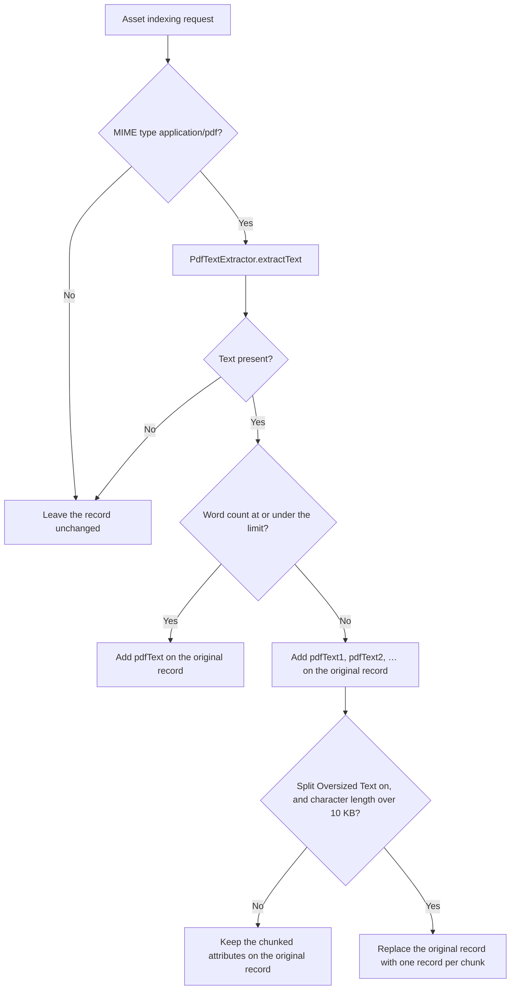

# PDF Text Extractor

`DefaultAlgoliaPdfTextExtractor` is an asset request extender. When the indexer prepares a record for a PDF asset, this service reads the document text and writes it onto the Algolia record so the PDF body is searchable.

Source: [`DefaultAlgoliaPdfTextExtractor`](../core/src/main/java/com/algolia/core/extender/internal/DefaultAlgoliaPdfTextExtractor.java).

---

## Table of contents

1. [When it runs](#when-it-runs)
2. [How text is stored](#how-text-is-stored)
3. [Record splitting](#record-splitting)
4. [Configuration](#configuration)
5. [LLM enrichment](#llm-enrichment)
6. [Backward compatibility](#backward-compatibility)
7. [Dependencies](#dependencies)

---

## When it runs

The component is an OSGi service with `service.description` **Algolia PDF Text Extractor**. It implements `AlgoliaAssetRequestExtender` only, so it appears in **Asset Request Extender Services** and not in the page list. You can select it together with other asset extenders, such as the [Tags Extractor](TAGS.md).

`augmentAlgoliaRequest` runs after the indexer has created the asset’s `AlgoliaRequest`. The method returns immediately unless the asset MIME type is `application/pdf`. Non-PDF assets, including a null MIME type, are left unchanged.

For a PDF, it calls the indexer’s `PdfTextExtractor.extractText`. Empty or null text is ignored. The original record is not given a text attribute in that case.

---

## How text is stored

Words are counted with OpenNLP `WhitespaceTokenizer`. The limit is **Word Size Limit** from Extension Settings. When that field is blank, the OSGi **Word Size Limit** is used (default **900**).

| Extracted text | Attributes written | Records |
|---|---|---|
| Word count ≤ limit | One attribute, `pdfText` (or the configured name), holding the full string | The original asset record |
| Word count > limit, and the string is 10 KB or shorter | `pdfText1`, `pdfText2`, … each holding up to the word limit | Still the original asset record |
| Word count > limit, the string is longer than 10 KB, and Split Oversized Text is on | Each chunk becomes the text attribute of its own record | The original record is removed. See [Record splitting](#record-splitting) |
| Word count > limit, the string is longer than 10 KB, and Split Oversized Text is off | Numbered chunks stay on the original record | The original asset record |

A chunk is the word limit words, joined with single spaces. The last chunk holds the remainder. Attribute numbering starts at `pdfText1` (or `{name}1`). There is no bare `pdfText` attribute once the word count exceeds the limit.

Example with the default limit of 900 and 1,801 words, while the string stays under 10 KB: the original record gains `pdfText1` (900 words), `pdfText2` (900 words), and `pdfText3` (1 word).

The 10 KB check uses `String.length()` on the full extracted text, not the size of the finished Algolia JSON record. The constant is `RECORD_SIZE_LIMIT` (`10 * 1024`). Text that is exactly 10 KB is not split into extra records.

---

## Record splitting

Splitting runs only when all of these are true: the word count is over the limit, `text.length()` is greater than 10 KB, and **Split Oversized Text** is on.

For each chunk, in order (`pdfText1`, `pdfText2`, …), the extender:

1. Builds a new `AlgoliaRecord` whose object ID is `{originalObjectID}_{index}`, starting at `0` for `pdfText1`.
2. Copies that chunk onto the new record under the base attribute name (`pdfText`, or the configured prefix and **Attribute Name**).
3. Sets `path` to the asset path (`AlgoliaConstants.ATTRIBUTE_PATH`).
4. Adds the record to the request.

It then removes the original record (the one whose object ID was captured before splitting). Other attributes that the indexer had placed on the original record are not copied onto the split records. Each split record contains the object ID, the text attribute, and `path`.

After the swap it calls `AlgoliaUtil.handleSplitRecordCount` with `SplitRecordAction.ADD`, the asset path, the number of remaining records, and the `ResourceResolverFactory`. It also sets `AlgoliaRequest.setPdfTextSplittingAttempted(true)` so the indexer can tell this path was taken.

---

## Configuration

Authors set these on the Cloud Service configuration, under **Extension Settings**, after selecting **Algolia PDF Text Extractor** in **Asset Request Extender Services**. The row starts collapsed. Hover the name to see `com.algolia.core.extender.internal.DefaultAlgoliaPdfTextExtractor`. Extenders below this row see the attributes it writes, including `pdfText` and, when enrichment is on, `pdfLanguage`. Place the [Tags Extractor](TAGS.md) below it when tag enrichment should use the PDF text.

The same row includes the [LLM enrichment](#llm-enrichment) fields. The badge reads **Defaults** until a field differs from its default, then shows how many fields are customized.

| Setting | Type | Default | Meaning |
|---|---|---|---|
| Word Size Limit | number | OSGi Word Size Limit, otherwise `900` | Maximum words stored in one text attribute before the text is partitioned |
| Attribute Name | text | `pdfText` | Base attribute name. Chunks use a number suffix, for example `pdfText1`. Letters, digits, `_`, and `-` only; an invalid name, or one that already exists on the record (such as `path`), falls back to `pdfText` |
| Attribute Prefix | text | empty | Prefix added to every attribute name, for example `doc_` → `doc_pdfText` |
| Split Oversized Text | checkbox | on | When the extracted text is longer than 10 KB, replace the original record with one record per chunk |

The OSGi metatype **DefaultAlgoliaPdfTextExtractor Configuration** still supplies the Word Size Limit used when the author leaves that field blank. Its property is `word.size.limit` on PID `com.algolia.core.extender.internal.DefaultAlgoliaPdfTextExtractor`.

A lower limit produces more numbered text attributes and, once the full string exceeds 10 KB and splitting is on, more Algolia records. A higher limit keeps more text on fewer attributes and can produce a record Algolia will reject if a single attribute or the record exceeds Algolia’s size limits. 900 words is the shipped default; validate record size against your index settings before raising it.

---

---

## LLM enrichment

After extracting text the extender can optionally call an OpenAI-compatible Chat Completions endpoint and write classification, summary, and additional metadata onto the Algolia record so that content is available as facets and for full-text search without any custom indexing pipeline.

### How it works

The full extracted text is sent to the endpoint as a chat message (after truncation to the admin's configured limit). The model must return a JSON object. The extender parses that object and writes the following attributes onto **every record** — the original record and every split record when record splitting replaced it:

| Attribute | Type | Description |
|---|---|---|
| `{prefix}pdfClassification` | String | Broad category of the document |
| `{prefix}pdfSummary` | String | One-paragraph summary |
| `{prefix}pdfTopics` | String array | Main topics (up to 20, de-duplicated) |
| `{prefix}pdfKeywords` | String array | Search keywords (up to 20, de-duplicated) |
| `{prefix}pdfLanguage` | String | ISO 639-1 language code |
| `{prefix}pdfDocumentType` | String | Sub-type of the document (policy, guide, report, …) |

Classification, summary, topics, keywords, and document type are written in the language of the PDF. A Spanish document produces Spanish topics and a Spanish summary; `pdfLanguage` stays a code such as `es`. `{prefix}` is the **Attribute Prefix** from the same Extension Settings row. An attribute is never written over one already on the record (for example `objectID` or `path`).

Enrichment is **fail-open**: if the HTTP call fails, if the model returns invalid JSON, or if the API key cannot be decrypted, only the `pdfText` attributes are indexed and the error is logged at warning level. Image-only PDFs that produce no text are skipped entirely.

The LLM call runs synchronously on the author indexing thread. Every publish and reindex triggers a call for each PDF asset, which adds latency and inference cost. Enable this feature only when the trade-off is acceptable.

### Author settings (Extension Settings row)

All LLM fields are marked **author-only**: AI Setup will not propose, change, or display any of these values.

| Setting | Type | Default | Description |
|---|---|---|---|
| Enable LLM Enrichment | checkbox | off | Must be on for any enrichment to happen. Existing installs are unaffected. |
| LLM Provider | dropdown | — | A provider from the **Algolia › LLM Providers** page. The provider holds the Inference URL, Model, and encrypted API key, so the Tags Extractor can use the same one. |
| System Prompt | textarea | Built-in JSON prompt, shown as the placeholder | Instructs the model to return JSON only, with classification, summary, topics, keywords, and document type written in the language of the document. Override to change the tone or add domain context. A custom prompt replaces this instruction, so keep the language rule if you still want enrichment in the source language. |
| User Prompt | textarea | `Analyze the following document text:\n\n{{pdfText}}` | Use `{{pdfText}}` as a placeholder for the truncated text. If the placeholder is absent, the text is appended. |

**LLM providers** are managed on the **Advanced** tab of the Cloud Configuration with **Add provider**. Each provider has a **Name**, **Inference URL**, **Model**, and **API Key**; the key is encrypted when the provider dialog is saved. **Test connection** in the dialog checks the provider against every LLM-capable extension before you save. A provider that this configuration does not define (for example one inherited from a parent configuration) is shown as not found and enrichment is skipped.

This extractor registers an inference probe, so the provider dialog's **Test connection** uses the same host allow-list, timeout, and response-format flag as PDF indexing.

### Upgrading existing inline-credential configurations

Existing configurations that stored **Inference URL**, **Model**, and **Inference API Key** directly in Extension Settings continue to work after upgrade (**1.2.0**): when no provider is selected, indexing reads those inline values. Opening the configuration moves them into a provider named after the model and selects it in this row. Save the configuration to keep the change.

### Deployment settings (OSGi)

These limits apply to all indexes on the AEM instance and are set by an administrator in the **DefaultAlgoliaPdfTextExtractor Configuration** (PID `com.algolia.core.extender.internal.DefaultAlgoliaPdfTextExtractor`):

| Property | Default | Description |
|---|---|---|
| `llm.allowed.hosts` | empty | Host patterns (with `*` wildcards) that the endpoint is allowed to contact. Same format as AI Setup's allow-list. Empty allows any host except link-local, wildcard, and multicast addresses; plain `http` is only allowed for localhost. Set it in production. |
| `llm.timeout.ms` | `30000` | HTTP socket and connect timeout in milliseconds. |
| `llm.max.tokens` | `1024` | Maximum tokens requested from the model. |
| `llm.max.input.chars` | `12000` | Characters of extracted text sent to the model. Longer texts are truncated. |
| `llm.json.response.format` | off | Send `response_format:{type:json_object}`. Only for endpoints that accept it. |

### Security notes

- The API key is stored as ciphertext in the configuration's `llmProviders` property in `/conf`. Anyone with read access to `/conf` can read the encrypted blob but not the plaintext.
- **Test connection** in the provider dialog sends the key to the author instance only for that call. It is not written to the repository.
- The admin allow-list (`llm.allowed.hosts`) prevents the author instance from being used as a proxy to reach arbitrary hosts.
- AI Setup never proposes, changes, or includes these fields in its model prompt.

---

## Backward compatibility

On upgrade from extensions **1.0.x**, a configuration that already selected this class keeps producing the same `pdfText` attributes. Settings JSON is empty, so every field uses the default in the table above.

| 1.0.x behavior | 1.1.0 default | 1.2.0 change |
|---|---|---|
| Attribute name always `pdfText` | **Attribute Name** defaults to `pdfText` | — |
| No attribute prefix | **Attribute Prefix** defaults to empty | — |
| Oversized text always split into extra records | **Split Oversized Text** defaults to on | — |
| Word limit from OSGi `word.size.limit` (900) | Blank **Word Size Limit** still reads that OSGi value | — |
| No LLM enrichment | — | **Enable LLM Enrichment** defaults to off; existing records are unchanged |
| Inline Inference URL / Model / API Key fields | Inline LLM credential fields in 1.1.0 | **1.2.0** replaces them with a shared **LLM Provider** drop-down. Saved inline credentials still work and move into a provider the next time the configuration is opened and saved. |

Turning **Split Oversized Text** off is new. Existing indexes are unchanged until an author unchecks it and reindexes.

A custom asset extender that copied this class before `ConfigurableRequestExtender` existed does not need to implement that interface. See [Installation — Backward compatibility](INSTALLATION.md#backward-compatibility).

---

## Dependencies

| Service or library | Use |
|---|---|
| `PdfTextExtractor` | Reads text from the DAM `Asset`. Provided by the indexer. This package also ships `PdfTextExtractorImpl` (Apache PDFBox) as a default. |
| `ResourceResolverFactory` | Passed to `AlgoliaUtil.handleSplitRecordCount` when records are split |
| `opennlp-tools` 2.5.0 | `WhitespaceTokenizer` for the word count and the partitions |

The extractor logs `Encountered PDF asset, extracting text from it.` at info when it sees a PDF.

---

**Related docs**

| Doc | Topics |
|---|---|
| [Installation](INSTALLATION.md) | Build, deploy, and select the extender |
| [Tags Extractor](TAGS.md) | The page and asset tags extender |
| [Property Value Introspector](INTROSPECTOR.md) | Abort indexing on a JCR property value |
| [Custom extensions](CUSTOM_EXTENSIONS.md) | The `AlgoliaAssetRequestExtender` contract |
