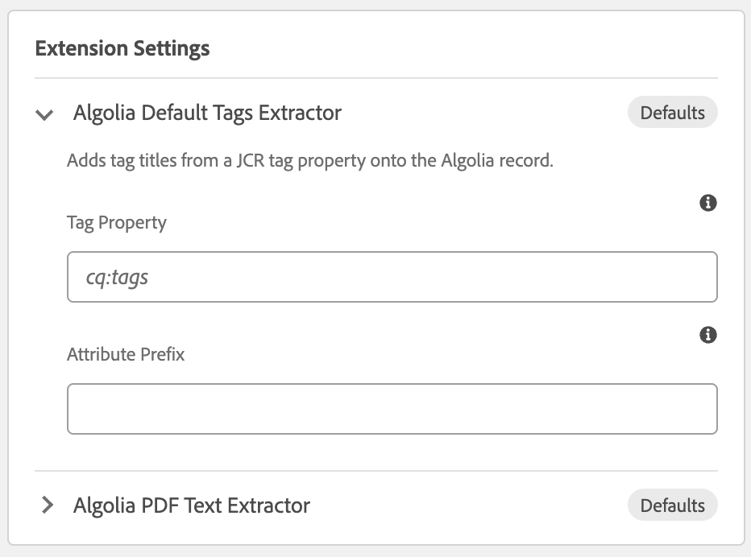

# Tags Extractor

`DefaultAlgoliaTagsExtractor` copies AEM tags onto the Algolia record for both pages and assets. It reads a JCR tag property and lets the indexer’s `TagsParserService` turn those tag IDs into record attributes. Optionally it can enrich every record with LLM-generated classification, summary, topics, keywords, language, and document type attributes.

Source: [`DefaultAlgoliaTagsExtractor`](../core/src/main/java/com/algolia/core/extender/internal/DefaultAlgoliaTagsExtractor.java).

---

## Table of contents

1. [Registration](#registration)
2. [Configuration](#configuration)
3. [What it writes](#what-it-writes)
4. [Page and asset entry points](#page-and-asset-entry-points)
5. [LLM enrichment](#llm-enrichment)
6. [Backward compatibility](#backward-compatibility)

---

## Registration

The class implements both extender interfaces and registers both OSGi services:

```java
@ComponentServiceProperties(description = "Algolia Tags Extractor")
@Component(
        service = {
                AlgoliaPageRequestExtender.class,
                AlgoliaAssetRequestExtender.class
        }
)
public class DefaultAlgoliaTagsExtractor
        implements AlgoliaPageRequestExtender, AlgoliaAssetRequestExtender,
        ConfigurableRequestExtender {
```

`@ComponentServiceProperties` sets `service.description` to **Algolia Tags Extractor**. That string is the label in the Cloud Service dropdowns. The value stored on the configuration is the class name `com.algolia.core.extender.internal.DefaultAlgoliaTagsExtractor`.

Select it independently for pages and for assets. You can also select it together with other asset extenders, such as the [PDF Text Extractor](PDF_TEXT.md):

| List | Select it when |
|---|---|
| **Page Request Extender Services** | Indexed pages should carry their tags |
| **Asset Request Extender Services** | Indexed assets should carry their tags |

One bundle installation covers both. Choosing it on only one list limits it to that resource type. Page and asset selections store settings separately, so the same extender can use a different Tag Property or Attribute Prefix on each configuration.

---

## Configuration

Authors set these on the Cloud Service configuration, under **Extension Settings**, after selecting **Algolia Tags Extractor**. The row starts collapsed. Hover the name to see `com.algolia.core.extender.internal.DefaultAlgoliaTagsExtractor`. Place this row below any extender whose attributes should be sent to the model. For a PDF, that means below the [PDF Text Extractor](PDF_TEXT.md).



| Setting | Type | Default | Meaning |
|---|---|---|---|
| Tag Property | text | `cq:tags` | JCR property that stores tag IDs. Pages are read from `jcr:content`, and assets from `jcr:content/metadata`. |
| Attribute Prefix | text | empty | Prefix added to every attribute name this extender emits, for example `cat_` → `cat_topic`. Letters, digits, `_`, and `-` only; an invalid prefix is ignored. |

The same row includes the [LLM enrichment](#llm-enrichment) fields. The badge reads **Defaults** while every field still uses its default, and shows how many fields are customized once you change one. Leaving Tag Property blank also falls back to `cq:tags`.

---

## What it writes

Both entry points call the same method. It reads the tag property named by the author, asks `TagsParserService` to turn those tag IDs into record attributes, then applies **Attribute Prefix** to the attributes it just added.

**Attribute Prefix** is prepended to every attribute this extender adds. `cat_` turns a `topic` attribute into `cat_topic`. A blank prefix leaves the names unchanged. The prefix may contain letters, digits, underscores, and hyphens.

Behavior that follows from this method:

- Tags are read from the resource already on the `AlgoliaRequest`, not by adapting the `Page` or `Asset` argument.
- Tag attributes are parsed once and written to **every record** on the request, including the original record retained when the [PDF Text Extractor](PDF_TEXT.md#record-splitting) split an asset and each of its split records. When a record already has a list attribute with the same name, the tag values are appended to it; any other existing value is replaced.
- LLM-generated attributes (`tagClassification`, `tagSummary`, etc.) are also written to every record, so every chunk carries the classification. They never overwrite an attribute already on the record.
- The shape of the tag attributes is defined by `TagsParserService` in the indexer, not by this class. This extender does not change tag titles or apply a locale. The prefix changes only the attribute name.

If the request has no records, `get(0)` throws. The indexer is expected to have created the initial record before extenders run.

---

## Page and asset entry points

```java
@Override
public void augmentAlgoliaRequest(AlgoliaRequest request, Asset asset) {
    this.addTagsToAlgoliaRecord(request);
}

@Override
public void augmentAlgoliaRequest(AlgoliaRequest request, Page page) {
    this.addTagsToAlgoliaRecord(request);
}
```

Tags are read from `request.getResource()`. The `Page` and `Asset` arguments are only used by LLM enrichment, for the path, title, and description. Two methods exist so the class satisfies both interfaces and can be selected in both lists. See [Building custom extensions](CUSTOM_EXTENSIONS.md).

---

## LLM enrichment

After extracting and indexing tags, the extender can optionally call an OpenAI-compatible Chat Completions endpoint and write classification, summary, and additional metadata onto the Algolia record.

### How it works

The extender builds the text sent to the endpoint from the page title and description (for an asset, `dc:title` and `dc:description`), followed by every text or list attribute already on the first record, including the tag titles it just added. `objectID`, `path`, and `type` are left out. When **Content Properties** lists names, only those Algolia attributes or JCR properties are sent (dotted paths such as `meta.jcr_title` are supported). Nothing is sent when that text is empty.

Because it reads the record as built so far, attributes written by extenders that run after the Tags Extractor are not included. In **Extension Settings**, place the Tags Extractor below any extender whose output should inform the model. The model is called **once per asset or page**, regardless of how many records the indexer created. The extender parses the JSON response and copies the attributes onto **every record** (including split records from the PDF Text Extractor):

| Attribute | Type | Description |
|---|---|---|
| `{prefix}tagClassification` | String | Broad category of the content |
| `{prefix}tagSummary` | String | One-paragraph summary |
| `{prefix}tagTopics` | String array | Main topics (up to 20, de-duplicated) |
| `{prefix}tagKeywords` | String array | Search keywords (up to 20, de-duplicated) |
| `{prefix}tagLanguage` | String | ISO 639-1 language code |
| `{prefix}tagDocumentType` | String | Sub-type of the content |

Classification, summary, topics, keywords, and document type are written in a language the extender picks before calling the model, in this order:

1. An authored language attribute on the record, such as `language` or `jcr:language`.
2. `pdfLanguage`, or another `*Language` attribute an earlier extender wrote. The extender's own `tagLanguage` is ignored.
3. The language of text earlier extenders put on the record, such as `pdfSummary` or `pdfText`, when common words clearly identify it.
4. English.

`tagLanguage` is set to that code, for example `en`. In **Extension Settings**, place the [PDF Text Extractor](PDF_TEXT.md) above the Tags Extractor so `pdfLanguage` and the PDF text are available. `{prefix}` is the **Attribute Prefix** from the same Extension Settings row. An attribute is never written over one already on the record.

Enrichment is **fail-open**: if the HTTP call fails, if the model returns invalid JSON, or if the API key cannot be decrypted, only the tag attributes are indexed and the error is logged at warning level.

### Author settings (Extension Settings row)

All LLM fields are marked **author-only**: AI Setup will not propose, change, or display any of these values.

| Setting | Type | Default | Description |
|---|---|---|---|
| Enable LLM Enrichment | checkbox | off | Must be on for any enrichment to happen. Existing installs are unaffected. |
| LLM Provider | dropdown | — | A provider from the **Algolia › LLM Providers** page. The PDF Text Extractor can use the same one. |
| Content Properties | text | empty (all properties) | By default the model receives every text property on the record, plus the page or asset title and description. Enter a comma-separated list to restrict that, for example `title, product, state, meta.jcr_title`. |
| System Prompt | textarea | Built-in JSON prompt | Instructs the model to return JSON only, with classification, summary, topics, keywords, and document type. Override to change the tone or add domain context. The language rule described above is appended to every prompt, including a custom one. |
| User Prompt | textarea | `Analyze the following content:\n\n{{content}}` | Use `{{content}}` as a placeholder for the text described above. If the placeholder is absent, the text is appended. |

This extractor registers an inference probe, so the provider dialog's **Test connection** on the Advanced tab uses the same OSGi host allow-list, timeout, and response-format flag as indexing.

### Deployment settings (OSGi)

These limits apply to all indexes and are set in the **DefaultAlgoliaTagsExtractor Configuration** (PID `com.algolia.core.extender.internal.DefaultAlgoliaTagsExtractor`):

| Property | Default | Description |
|---|---|---|
| `llm.allowed.hosts` | empty | Host patterns with `*` wildcards. Empty allows any host except link-local, wildcard, and multicast; plain `http` is only allowed for localhost. |
| `llm.timeout.ms` | `30000` | HTTP socket and connect timeout in milliseconds. |
| `llm.max.tokens` | `1024` | Maximum tokens requested from the model. |
| `llm.max.input.chars` | `8000` | Characters of text sent to the model. Longer text is truncated. |
| `llm.json.response.format` | off | Send `response_format:{type:json_object}`. Only for endpoints that accept it. |

---

## Backward compatibility

On upgrade from extensions **1.0.x**, a configuration that already selected this class keeps working without a save. Settings JSON is empty, so the extender uses `cq:tags` and no prefix — the same attributes as before.

| 1.0.x behavior | 1.1.0 default | 1.2.0 change |
|---|---|---|
| Always read `cq:tags` | **Tag Property** defaults to `cq:tags` | — |
| No attribute prefix | **Attribute Prefix** defaults to empty | — |
| Dropdown label **Algolia Default Tags Extractor** | Dropdown label **Algolia Tags Extractor**. The stored class name is unchanged. | — |
| No LLM enrichment | — | **Enable LLM Enrichment** added and defaults to **off**. Existing records are unchanged. LLM providers are managed on the Cloud Config **Advanced** tab. Requires indexer 5.0.0. |
| Tags written to the first record only | Tags written to **every record**, including split PDF records | Split records of a PDF asset now carry the tag attributes, so filtering by tag also matches them. |

Upgrading to 1.2.0 requires indexer **5.0.0 or newer**. See [Installation — Backward compatibility](INSTALLATION.md#backward-compatibility) for the full upgrade sequence.

A custom extender that copied this class before `ConfigurableRequestExtender` existed does not need to implement that interface. It still runs; it just has no settings row. See [Installation — Backward compatibility](INSTALLATION.md#backward-compatibility).

---

**Related docs**

| Doc | Topics |
|---|---|
| [Installation](INSTALLATION.md) | Build, deploy, and select the extender |
| [PDF Text Extractor](PDF_TEXT.md) | Asset-only text extraction and record splitting |
| [Property Value Introspector](INTROSPECTOR.md) | Abort indexing on a JCR property value |
| [Custom extensions](CUSTOM_EXTENSIONS.md) | `@ComponentServiceProperties` and the extender interfaces |
